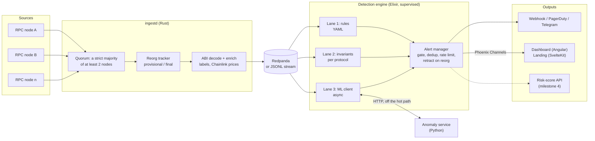
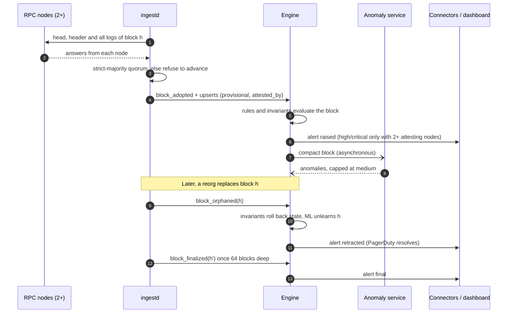
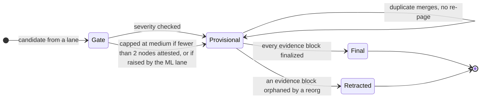
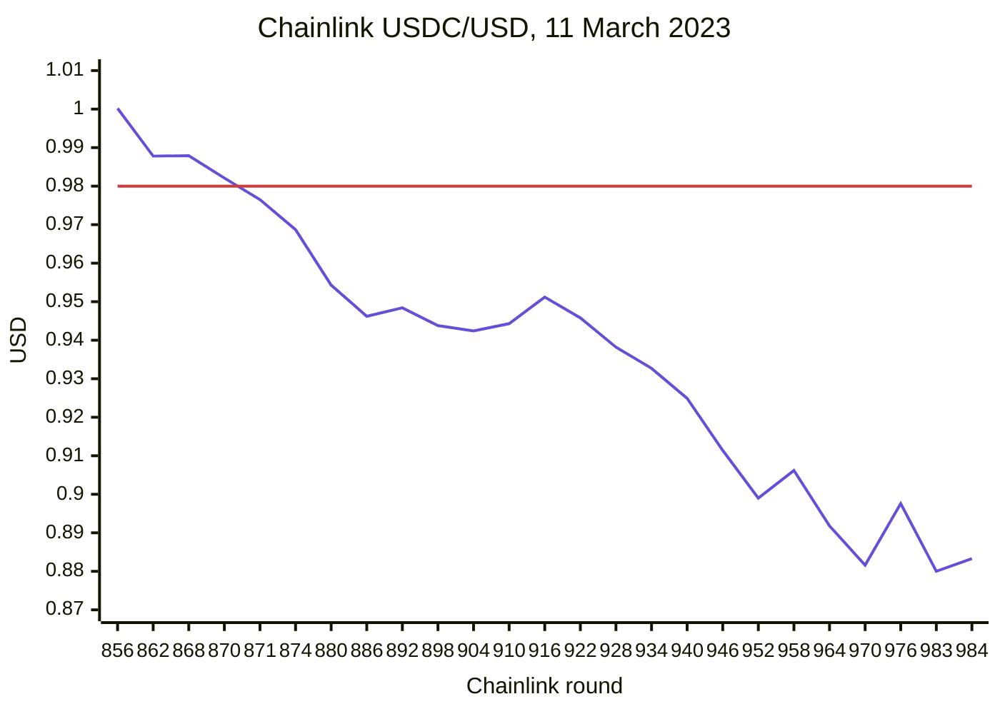
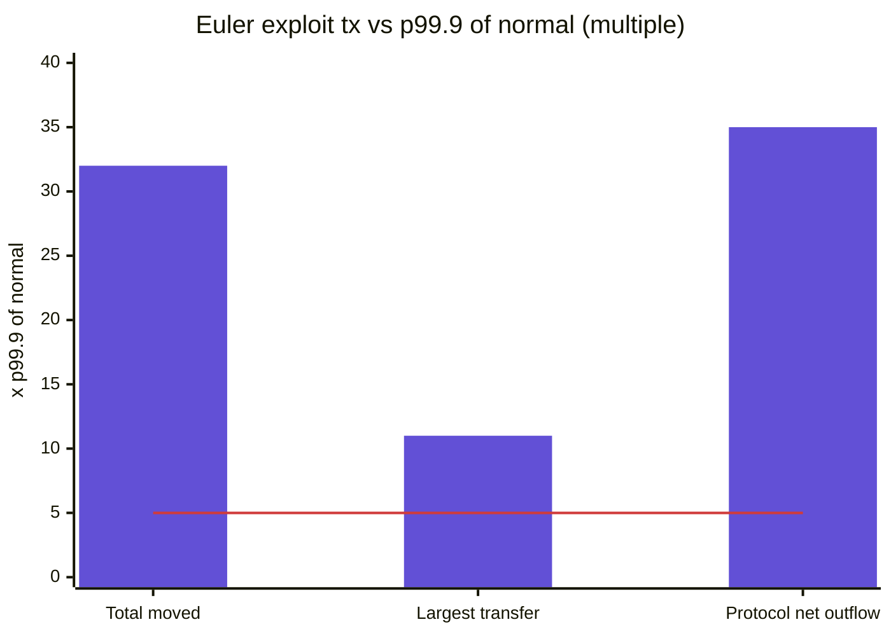

# ChainGuard

[](https://github.com/Arfazrll/ChainGuard-Protocol/actions/workflows/ci.yml)
[](LICENSE)


**Real-time on-chain risk and threat monitoring.** ChainGuard watches a blockchain live and verifies every block across independent nodes. It detects attacks and protocol failures as they happen, in three detection lanes, and raises alerts that carry the exact on-chain evidence behind them.

**Read-only by design.** ChainGuard never holds a key, never signs and never sends a transaction. It is a watchtower, not a trader. If it were breached, there would be nothing to steal.

| Milestone | Scope | Status |
|---|---|---|
| 1 | Reorg-safe multi-node ingestion (Rust) | Done |
| 2 | Rule engine, Broadway consumer, alert connectors, live dashboard | Done |
| 3 | Per-protocol invariants, ML anomaly service, fund-flow graph, landing page | Done |
| 4 | Risk-score API, tamper-evident audit trail, one-command self-host, hosted demo | Next |

Nothing in this README claims more than what is in the repository. Every figure below comes from a test or a recorded run, with its conditions stated.

## Contents

- [Architecture](#architecture)
- [From block to alert](#from-block-to-alert)
- [Detection lanes](#detection-lanes)
- [Proof on real incidents](#proof-on-real-incidents)
- [Measured results](#measured-results)
- [Run it locally](#run-it-locally)
- [Configuration](#configuration)
- [Tests and CI](#tests-and-ci)
- [Repository layout](#repository-layout)
- [Platform invariants](#platform-invariants)
- [Documentation](#documentation)

## Architecture



| Layer | Technology | Why |
|---|---|---|
| Ingestion | Rust (alloy primitives), allowlisted JSON-RPC client | CPU-heavy decoding that must run for days without leaking. The only process that talks to nodes, and it can only call read methods. |
| Stream bus | Redpanda (Kafka API), or JSONL for replay and local runs | Decouples ingestion from detection; streams are replayable. |
| Detection | Elixir, Phoenix, Broadway | One supervised process per rule and per invariant. A crash restarts that monitor alone. Backpressure comes from Broadway. |
| ML | Python 3.12, scikit-learn, uv | Kept off the hot path as a separate service. |
| Frontends | Angular (dashboard), SvelteKit (landing), Cytoscape.js | Live updates over Phoenix Channels. |

## From block to alert



Every alert has a lifecycle that follows the blocks its evidence came from:



Final alerts are never retracted: ingestion halts loudly rather than rewrite finalized history.

## Detection lanes

### Lane 1: rules for known attacks

Rules are YAML data, validated at load, and each runs in its own supervised process. Format: [docs/rules.md](docs/rules.md).

| Rule | Severity | Catches |
|---|---|---|
| `flash-loan-drain` | critical | A flash-loan transaction in which a labeled protocol ends with a large *net* USD outflow |
| `privileged-change` | high | Proxy upgrade, admin change, ownership transfer or role grant on a known protocol |
| `emergency-pause` | high | A known protocol emits `Paused` |
| `approval-farming` | medium | 8 or more wallets give unlimited approval to the same new, unknown spender within 50 blocks |
| `mixer-interaction` | low | Funds move into or out of a labeled mixer |

### Lane 2: invariants per protocol

Properties that must always hold, one supervised monitor each. A monitor snapshots its state per block and rolls back when a reorg orphans a block. Format: [docs/invariants.md](docs/invariants.md).

| Kind | Bundled monitors | Fires when |
|---|---|---|
| `peg` | USDC, USDT, DAI (Chainlink) | The price enters a wider band than before: 2% off peg is high, 5% is critical |
| `oracle` | ETH/USD, BTC/USD | One update moves more than 10% (high), or the feed is older than 90 minutes at block time (medium) |
| `outflow` | Euler, Aave, Compound V3, Balancer | Net USD outflow from the protocol's labeled contracts over 50 blocks exceeds its limit |

### Lane 3: ML for the unknown

A separate Python service ([services/anomaly](services/anomaly/README.md)) runs three online models. Every observation is keyed by block hash, so a reorged block is unlearned, and anomalous observations never enter training.

| Model | Learns | Flags |
|---|---|---|
| Protocol flow baseline | Each protocol's net outflow in its active blocks | A material outflow far above its own median (robust z-score) |
| Fund-flow graph (IsolationForest) | The shape of every token-moving transaction | A top-0.5% score **and** a dollar feature at 5x or more of the 99.9th percentile of normal |
| Novel patterns | Which event kinds each labeled contract emits | The first occurrence of a kind after warm-up |

ML alerts are **capped at medium**, enforced twice in the engine and checked by CI. If the service is down, the lane reports `degraded` and skips blocks; the other two lanes are never delayed.

**Alerts** from all lanes carry severity, weakness class, transaction hashes, log indexes, block hashes and the nodes that attested the evidence. Connectors: HMAC-signed webhooks, PagerDuty Events v2 (resolves on retraction) and Telegram.

## Proof on real incidents

Incident fixtures are real mainnet blocks captured by `ingestd` from two independent providers. CI replays them through the full Broadway pipeline on every change.

| Incident | What ChainGuard raises |
|---|---|
| **Euler Finance exploit**, 13 Mar 2023, block 16,817,996 | **Rule:** `flash-loan-drain`, critical. Euler net outflow **$8,904,507** in tx `0xc310…111d`, matching published post-mortems (~8.87M DAI).<br>**Invariant:** `euler-outflow`, critical, on the same tx.<br>**ML:** the same tx, flagged on three dollar features.<br>Nothing else in the block's 410 records is high or critical. |
| **USDC depeg**, 11 Mar 2023, blocks 16,802,107 and 16,802,135 | Quiet at Chainlink round 870 ($0.98214, inside the 2% band). At round 871 ($0.97652), exactly one high alert: `USDC/USD at $0.9765: 2.35% off its $1.0000 peg (band 2.00%)` |
| Ordinary 2026 mainnet traffic, 827 records | Nothing high or critical |

**USDC/USD on Chainlink during the depeg** (rounds 856 to 984, blocks 16,795,835 to 16,803,482). The `usdc-peg` invariant fires once at round 871, the first answer outside the 2% band (red line at $0.98). After that it stays quiet while the price remains in the same band, and would escalate to critical below $0.95.



**Why the ML lane flags the Euler transaction.** Each bar is how far the exploit transaction sits above the 99.9th percentile of the 200 ordinary blocks before it. A dollar feature needs 5x or more (red line) to raise an alert.



## Measured results

| What | Result | Conditions |
|---|---|---|
| Live run, all three lanes | 45 consecutive blocks, 7,048 txs, 50,082 records, every block attested by 2 providers. 0 high or critical alerts on ordinary traffic. ML lane: 44 of 44 blocks scored, 0 errors, 0 skipped | Ethereum mainnet, `publicnode` + `drpc`, 2026-11-10 |
| Rules + invariants per block | p50 267 ms, p95 493 ms | 5 rules + 9 invariants, ~1,100 records per block, one Windows dev machine |
| Pipeline latency (record derived, then rules evaluated) | p50 about 530 to 600 ms | JSONL tail with 250 ms polling; not a benchmark |
| ML false positives | 2 of ~15,500 transactions in 200 real blocks before the Euler exploit. 1 transaction in the 45 live blocks ($25.1M moved across 30 addresses) | Shipped thresholds, medium severity, rate-limited |
| Longest ingestion run | 31 consecutive blocks, 146 to 2,486 logs each, 0 errors | Milestone 1 run, same providers |
| Block timestamp to detection | **Not measured** | The dev machine's clock was ~117 s behind. ChainGuard detected the skew and withheld the figure instead of reporting a wrong one |

## Run it locally

Requirements: Rust 1.88+, Erlang/OTP 29 with Elixir 1.20, Node 24, Python 3.12 with [uv](https://docs.astral.sh/uv/).

```sh
# 1. Ingest Ethereum mainnet from two independent public RPCs into a JSONL stream
cp config/ingestd.example.toml config/ingestd.toml     # set sink.path = "var/stream.jsonl"
cargo run --release -p chainguard-ingestd -- -c config/ingestd.toml

# 2. ML anomaly service (optional: without it the ML lane reports "disabled")
cd services/anomaly && uv sync && uv run chainguard-anomaly serve --port 8700

# 3. Detection engine, following the stream   -> http://localhost:4000/api/health
cd apps/engine && mix deps.get
CHAINGUARD_SOURCE=jsonl CHAINGUARD_JSONL_PATH=../../var/stream.jsonl \
CHAINGUARD_ANOMALY_URL=http://127.0.0.1:8700 mix phx.server

# 4. Dashboard -> http://localhost:4300        Landing page -> http://localhost:4400
cd apps/dashboard && npm ci && npx ng serve
cd apps/landing && npm ci && npm run dev
```

Replay a real incident instead of following the chain:

```sh
cd apps/engine
CHAINGUARD_SOURCE=jsonl CHAINGUARD_JSONL_MODE=replay \
CHAINGUARD_JSONL_PATH=test/fixtures/incidents/euler-finance-2023-03-13.jsonl mix phx.server
```

| Service | Port | Endpoints |
|---|---|---|
| Engine | 4000 | `/api/health`, `/api/stats`, `/api/lanes`, `/api/rules`, `/api/invariants`, `/api/alerts`, socket `/socket` (`alerts:global`, `live:<chain>`) |
| Anomaly service | 8700 | `POST /v1/blocks`, `POST /v1/orphan`, `GET /v1/model`, `GET /healthz` |
| Dashboard | 4300 | `?engine=` to point at another engine |
| Landing page | 4400 | Live when an engine is reachable, otherwise a labeled recorded run |

## Configuration

Ingestion is configured in TOML (`config/ingestd.example.toml`): nodes, quorum, confirmations, labels, Chainlink price feeds and the sink. Keep API keys out of the file: `url_env` reads a node URL from the environment.

The engine reads environment variables:

| Variable | Purpose |
|---|---|
| `CHAINGUARD_SOURCE` | `jsonl`, `kafka` or `none` |
| `CHAINGUARD_JSONL_PATH`, `CHAINGUARD_JSONL_MODE` | Stream file, and `tail` (default) or `replay` |
| `CHAINGUARD_KAFKA_HOSTS`, `CHAINGUARD_KAFKA_TOPICS` | Redpanda consumer |
| `CHAINGUARD_ANOMALY_URL` | ML service; unset disables the lane |
| `CHAINGUARD_WEBHOOK_URL`, `CHAINGUARD_WEBHOOK_SECRET` | HMAC-signed webhook |
| `CHAINGUARD_PAGERDUTY_ROUTING_KEY` | PagerDuty Events v2 |
| `CHAINGUARD_TELEGRAM_BOT_TOKEN`, `CHAINGUARD_TELEGRAM_CHAT_ID` | Telegram |
| `CHAINGUARD_*_MIN_SEVERITY` | Per-connector severity floor |
| `CHAINGUARD_CORS_ORIGINS` | Allowed browser origins (default: the local dashboard and landing page) |

## Tests and CI

| Suite | Command | Tests |
|---|---|---|
| Rust ingestion | `cargo test --workspace` | 45, plus 1 Anvil reorg test that runs in CI |
| Elixir engine | `cd apps/engine && mix test` | 61, including incident replays |
| Python ML service | `cd services/anomaly && uv run pytest` | 16, including 200 real mainnet blocks |
| Dashboard | `cd apps/dashboard && npx ng test --watch=false` | 10 |
| Landing page | `cd apps/landing && npm test` | 7 |
| Invariant guard | `scripts/check-invariants.sh` | Blocks merges |

CI runs seven jobs on every push and pull request: Rust (fmt, clippy, tests), the invariant guard, the Anvil reorg test, the engine with incident replays, the ML service, the dashboard and the landing page.

The invariant guard fails the build if any of these are removed or weakened: read-only enforcement, multi-node verification, reorg handling, the alert-layer guards (single-source cap, retraction, dedup, rate limit), invariant rollback, or the ML lane's medium ceiling. The guard itself was mutation-tested: deliberately weakening guarded code (an engine alert-layer guard, the ML lane's never-learn-anomalies rule) made it fail.

## Repository layout

```text
crates/
  ingest-core/        quorum source, reorg tracker, ABI decoding, enrichment
  rpc/                allowlisted read-only JSON-RPC client
  ingestd/            ingestion daemon (JSONL or Kafka sink, checkpoints)
apps/
  engine/             Elixir detection engine: rules, invariants, ML client, alerts, API
    priv/rules/         YAML detection rules
    priv/invariants/    YAML invariant monitors
    test/fixtures/      real incident blocks for replay tests
  dashboard/          Angular live dashboard with the fund-flow graph
  landing/            SvelteKit landing page (static)
services/
  anomaly/            Python ML anomaly service
data/labels/          public address labels (EIP-55 checked)
config/               ingestd configuration examples
deploy/               ClickHouse schema, Compose and Dockerfile (not yet run end to end)
docs/                 rule and invariant formats, architecture decision records
scripts/              invariant guard used by CI
```

## Platform invariants

These hold in every change. CI enforces 1, 2, 3 and 5.

1. **Read-only.** No keys, no signing, no transactions.
2. **Never trust a single node.** High and critical alerts need evidence attested by at least two independent nodes.
3. **Reorg-safe.** Everything is provisional until final; retract and re-emit on reorg.
4. **Tamper-evident audit trail** for every alert and score *(milestone 4)*.
5. **No false urgency.** Dedup, rate limits, evidence on every alert, and an ML lane that never pages.
6. **Tenant isolation** of watchlists, labels and routing *(milestone 4; until then the socket serves public data only)*.
7. **No market-manipulation surface.** ChainGuard reports risk and never acts on it.

## Documentation

- [Writing detection rules](docs/rules.md)
- [Invariant monitors](docs/invariants.md)
- [ML anomaly service](services/anomaly/README.md)
- [ADR-0001: reorg-safe multi-node ingestion](docs/adr/0001-reorg-safe-multi-node-ingestion.md)
- [ADR-0002: detection engine and alert lifecycle](docs/adr/0002-detection-engine-and-alert-lifecycle.md)
- [ADR-0003: invariants, the ML lane and the fund-flow graph](docs/adr/0003-invariants-ml-lane-and-fund-flow-graph.md)

**Known limits.** Token prices come from labels (stablecoins) and from Chainlink feeds after their first update following start-up. Outflow invariants see priced transfers, not contract balances. Monitor and model state is in memory and re-warms after a restart. The Redpanda and Compose path has not yet been run end to end. These are tracked in the ADRs.

## License

[MIT](LICENSE)
